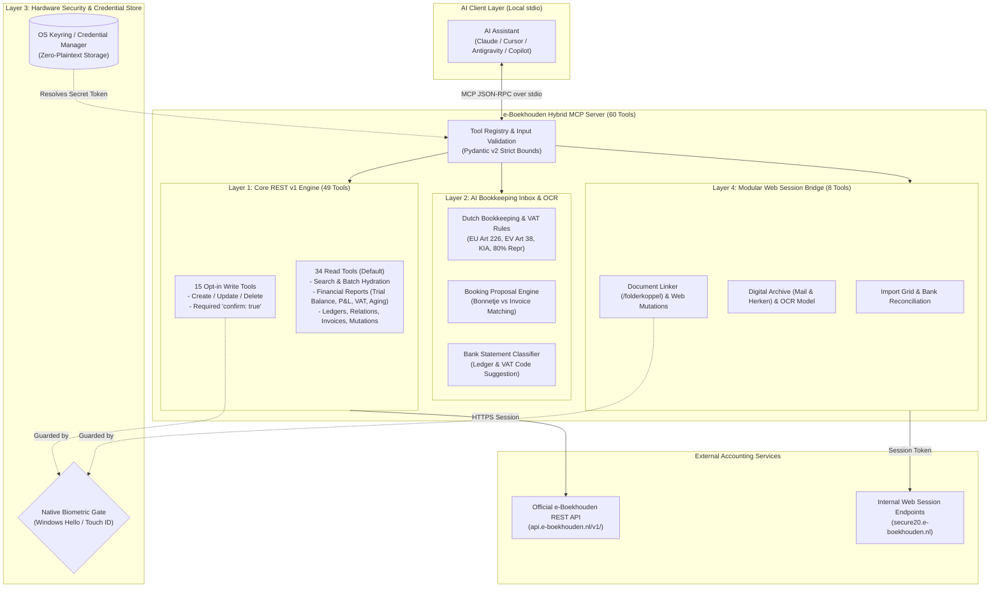

<p align="center">
  
</p>

<h1 align="center">e-Boekhouden Hybrid MCP Server</h1>

<p align="center">
  A secure, local Model Context Protocol (MCP) server combining the complete 49-tool REST v1 e-Boekhouden engine with AI bookkeeping heuristics, Dutch VAT classification, native OS biometric hardware gating (Windows Hello & Touch ID), and an optional web session bridge.
</p>

<p align="center">
  
  
  
  
  
  <a href="LICENSE"></a>
</p>

<p align="center">
  <a href="#architectural-layers">Architecture</a> ·
  <a href="#quick-start">Quick start</a> ·
  <a href="#ai-client-configuration">AI assistants</a> ·
  <a href="#tool-catalog-60-tools">Tool catalog</a> ·
  <a href="#security--biometric-hardware-gate">Biometric security</a> ·
  <a href="#configuration">Configuration</a> ·
  <a href="#credits--attribution">Credits & Attribution</a>
</p>

---

Connect **Claude Desktop**, **Cursor**, **Antigravity**, **VS Code**, **Windsurf**, **Gemini CLI**, or any local MCP-compatible assistant directly to your **e-Boekhouden.nl** administration. The server runs entirely on your local machine over standard I/O (stdio): no credentials pass through third-party servers, and all write operations require physical user presence verification.

> [!IMPORTANT]
> Bring your own e-Boekhouden API token. This independent community project is licensed under the MIT License and is not affiliated with or endorsed by e-Boekhouden.nl.

---

## Architectural Layers

The e-Boekhouden Hybrid MCP architecture integrates 4 complementary layers into a unified, secure accounting surface:



### 1. Core REST v1 MCP Surface (49 Tools)
- **34 Read-Only Tools (Default)**: Fast search, bounded batch hydration, financial reports (Trial Balance, Profit & Loss, Balance Sheet, VAT summaries, AR/AP aging, ledger transactions), and resource inspection.
- **15 Opt-in Write Tools**: Create invoices, book mutations, manage relations, products, ledgers, cost centers, and members. Every write requires explicit server configuration and client parameter confirmation.

### 2. AI Bookkeeping Inbox & OCR Classification (3 Tools)
- `get_dutch_bookkeeping_rules`: Authoritative Dutch tax rules, VAT decision trees (HOOG 21%, LAAG 9%, GEEN, VERL_INK reverse charge, EU Directive Art 226, Art 38 EV charging), receipt (*bonnetje*) detection heuristics, and Dutch tax deduction guidelines (KIA, 80% representation).
- `prepare_booking_proposal`: Automatically parses structured invoice/receipt metadata, cross-references live relations and ledger accounts in e-Boekhouden, and synthesizes balanced booking payloads for `create_mutation` or `create_invoice`.
- `suggest_transaction_classification`: Classifies raw bank statement descriptions, recommending appropriate debit/credit ledgers, VAT codes, and mutation types.

### 3. Native OS Biometric Hardware Gate & Keyring Store
- **Hardware User Presence Verification**: Any destructive or mutating operation (`create_invoice`, `create_mutation`, `delete_*`) triggers a native OS biometric prompt (**Windows Hello** face/fingerprint/PIN or **macOS Touch ID** / `LocalAuthentication`).
- **Dynamic Context Prompts**: Biometric modals display financial details in the prompt (e.g. `Approve POST Invoice for EUR 1,250.00 to Relation 42?`).
- **Fail-Closed Design**: Rejections, timeouts, or missing biometric hardware immediately abort the tool call before touching the remote API.
- **OS Keyring Integration**: Securely loads API tokens directly from Windows Credential Manager or macOS Keychain, eliminating plaintext tokens in `.env` files.

### 4. Modular Web Session Bridge (8 Tools)
- `get_unprocessed_bank_transactions`: Inspects unprocessed bank statements directly from e-Boekhouden's internal import grid.
- `suggest_mutation_for_bank_statement`: Queries the internal suggestion engine for pre-filled booking parameters.
- `list_archive_folders`: Lists Digital Archive folders (including Mail & Herken inbox folders) via `/v1/api/folder/directory`.
- `list_archive_files`: Lists files and Mail & Herken recognition status (`menHStatus`, `koppelCount`) inside a Digital Archive folder via `/v1/api/folder/{folder_id}/filelist`.
- `get_recognized_invoice_model`: Retrieves the internal AI OCR recognition model (`mutatie`, `mutatieRegels`, `suggestedAiIban`, `suggestedAiBtwNr`) for a Digital Archive file via `/v1/api/mutatie/folder/{file_id}/model`.
- `get_mutation_model_by_number`: Retrieves the editable web mutation model (`mutatie`, `mutatieRegels`, `folderKoppelId`) by mutation number (`nr`) via `/v1/api/mutatie/nr/{mutation_number}/model`.
- `save_web_mutation`: Creates or updates a mutation in the web UI format via `POST /v1/api/mutatie`, gated by `enable_write_tools`, `confirm=True` / `confirm_write=True`, and biometric verification.
- `attach_file_to_mutation`: Directly links uploaded digital archive receipts or invoices to journal mutations via `/v1/api/folderkoppel/koppel/item`.

---

## Tool Catalog (60 Tools)

| Category | Read Tools (Enabled by Default) | Write Tools (Gated by Double-Lock + Biometrics) |
|---|---|---|
| **Relations** | `list_relations`, `get_relation`, `search_relations`, `get_relations_batch` | `create_relation`, `update_relation`, `delete_relation` |
| **Invoices** | `list_invoices`, `get_invoice`, `search_invoices`, `get_invoices_batch` | `create_invoice` |
| **Mutations** | `list_mutations`, `get_mutation`, `list_outstanding_invoices`, `search_mutations`, `get_mutations_batch` | `create_mutation` |
| **Products** | `list_products`, `get_product`, `list_product_groups` | `create_product`, `update_product`, `delete_product` |
| **Ledgers** | `list_ledgers`, `get_ledger`, `get_ledger_balance` | `create_ledger`, `update_ledger` |
| **Cost Centers** | `list_cost_centers`, `get_cost_center` | `create_cost_center`, `delete_cost_center` |
| **Members** | `list_members`, `get_member` | `create_member`, `delete_member` |
| **Administration** | `list_administrations`, `list_linked_administrations` | — |
| **Templates & Units**| `list_invoice_templates`, `list_email_templates`, `list_units` | — |
| **Financial Reports** | `get_trial_balance`, `get_profit_loss`, `get_balance_sheet`, `get_vat_summary`, `get_ar_ap_aging`, `get_ledger_transactions` | — |
| **AI Bookkeeping Inbox** | `get_dutch_bookkeeping_rules`, `prepare_booking_proposal`, `suggest_transaction_classification` | — |
| **Digital Archive** | — | `send_file_to_digital_archive` |
| **Web Session Bridge** | `get_unprocessed_bank_transactions`, `suggest_mutation_for_bank_statement`, `list_archive_folders`, `list_archive_files`, `get_recognized_invoice_model`, `get_mutation_model_by_number` | `attach_file_to_mutation`, `save_web_mutation` |

---

## Security & Biometric Hardware Gate

The server enforces a rigorous **triple-lock security model** for mutating operations:

1. **Lock 1 (Server Policy)**: Write tools are not registered or advertised to the AI assistant unless `EBOEKHOUDEN_MCP_ENABLE_WRITE_TOOLS=true`.
2. **Lock 2 (Explicit AI Confirmation)**: Every write tool schema strictly requires `confirm: true`. The assistant must present the exact action, identifiers, and monetary values to the user and obtain affirmative consent.
3. **Lock 3 (Native Hardware Biometrics)**: Before executing the write request against the e-Boekhouden API, the server invokes the host operating system's authentication layer:
   - **Windows**: `Windows.Security.Credentials.UI.UserConsentVerifier` (Windows Hello IR Camera, Fingerprint Sensor, or FIDO2 Security Key).
   - **macOS**: `LocalAuthentication` framework / Touch ID.
   - **Linux / Headless**: Fails closed unless biometric verification is explicitly disabled by the operator.

### Testing Biometrics from the CLI

Verify your OS biometric setup without launching an MCP client:

```powershell
# Windows
eboekhouden-mcp --test-biometric
```

```bash
# macOS
python -m eboekhouden_mcp.server --test-biometric
```

---

## Keyring Credential Store Setup

Rather than storing your API secret token in plaintext in `.env` files, use your operating system's credential vault:

### Windows Credential Manager

```powershell
# Store token securely in Windows Credential Manager
python -c "import keyring; keyring.set_password('eboekhouden_mcp', 'secret_token', 'your-secret-api-token-here')"
```

### macOS Keychain

```bash
# Store token securely in macOS Keychain
python3 -c "import keyring; keyring.set_password('eboekhouden_mcp', 'secret_token', 'your-secret-api-token-here')"
```

When configured, the MCP server automatically resolves the token on startup without requiring `EBOEKHOUDEN_MCP_SECRET_TOKEN` in the environment.

---

## Configuration

Settings are configured via environment variables or a `.env` file in the working directory:

| Environment Variable | Required | Default | Description |
|---|:---:|:---:|---|
| `EBOEKHOUDEN_MCP_SECRET_TOKEN` | Yes* | — | e-Boekhouden REST API token (*Optional if stored in Keyring) |
| `EBOEKHOUDEN_MCP_ENABLE_WRITE_TOOLS` | No | `false` | Expose create, update, and delete tools |
| `EBOEKHOUDEN_MCP_REQUIRE_BIOMETRIC` | No | `true` | Enforce native Windows Hello / Touch ID biometric challenge on writes |
| `EBOEKHOUDEN_MCP_KEYRING_SERVICE` | No | `eboekhouden_mcp` | Service name used for OS Keyring lookup |
| `EBOEKHOUDEN_MCP_ENABLE_WEB_SESSION` | No | `false` | Enable web session bridge tools (bank import grid, attachment linking) |
| `EBOEKHOUDEN_MCP_WEB_SESSION_TOKEN` | No | — | Session authentication token for web session endpoints |
| `EBOEKHOUDEN_MCP_WEB_SESSION_BASE_URL` | No | `https://secure20.e-boekhouden.nl` | Base URL for internal web session requests |
| `EBOEKHOUDEN_MCP_API_URL` | No | `https://api.e-boekhouden.nl/` | Official e-Boekhouden REST API endpoint |
| `EBOEKHOUDEN_MCP_ALLOW_CUSTOM_API_URL` | No | `false` | Restrict connections strictly to official API host unless set to `true` |
| `EBOEKHOUDEN_MCP_SOURCE` | No | `MCP-Server` | Source identifier logged with API requests |
| `EBOEKHOUDEN_MCP_LOG_LEVEL` | No | `WARNING` | Diagnostics level logged to stderr (`DEBUG`, `INFO`, `WARNING`, `ERROR`) |
| `EBOEKHOUDEN_MCP_ENABLE_ARCHIVE_TOOL` | No | `false` | Enable Microsoft Graph digital archive mailbox delivery |
| `EBOEKHOUDEN_MCP_ARCHIVE_ROOT` | Archive only | — | Local directory path allowlisted for archive reading |

---

## AI Client Configuration

### Antigravity & Gemini CLI

Add to your `mcp_config.json` (e.g. `~/.gemini/config/mcp_config.json`):

```json
{
  "mcpServers": {
    "eboekhouden": {
      "command": "/path/to/eboekhouden-mcp/.venv/Scripts/eboekhouden-mcp.exe",
      "args": []
    }
  }
}
```

Or via Python module:

```json
{
  "mcpServers": {
    "eboekhouden": {
      "command": "/path/to/eboekhouden-mcp/.venv/Scripts/python.exe",
      "args": ["-m", "eboekhouden_mcp.server"]
    }
  }
}
```

### Claude Desktop

Add to `claude_desktop_config.json`:

```json
{
  "mcpServers": {
    "eboekhouden": {
      "command": "/path/to/eboekhouden-mcp/.venv/bin/eboekhouden-mcp",
      "args": [],
      "env": {
        "EBOEKHOUDEN_MCP_ENABLE_WRITE_TOOLS": "false",
        "EBOEKHOUDEN_MCP_REQUIRE_BIOMETRIC": "true"
      }
    }
  }
}
```

### Cursor

Add to `.cursor/mcp.json` or Global MCP Settings:

```json
{
  "mcpServers": {
    "eboekhouden": {
      "command": "python",
      "args": ["-m", "eboekhouden_mcp.server"],
      "env": {
        "EBOEKHOUDEN_MCP_ENABLE_WRITE_TOOLS": "true",
        "EBOEKHOUDEN_MCP_REQUIRE_BIOMETRIC": "true"
      }
    }
  }
}
```

### Claude Code

```bash
claude mcp add-json --scope user eboekhouden \
  '{"type":"stdio","command":"/path/to/eboekhouden-mcp/.venv/bin/eboekhouden-mcp","args":[]}'
```

---

## Quick Start

### 1. Installation

Requires Python 3.10+ and [`uv`](https://docs.astral.sh/uv/) or standard virtual environments:

```bash
# Clone the repository
git clone https://github.com/matisup10/e-Boekhouden-MCP.git
cd e-Boekhouden-MCP

# Create virtual environment and install dependencies
uv venv
source .venv/bin/activate    # On Windows: .\.venv\Scripts\Activate.ps1
uv pip install -e ".[dev]"
```

### 2. Configure Token

Using Keyring (Recommended):

```bash
python -c "import keyring; keyring.set_password('eboekhouden_mcp', 'secret_token', 'your-token-here')"
```

Or copy `.env.example` to `.env`:

```bash
cp .env.example .env
# Edit .env and supply your EBOEKHOUDEN_MCP_SECRET_TOKEN
```

### 3. Verify Configuration

```bash
eboekhouden-mcp --check-config
```

### 4. Run the Test Suite

```bash
pytest --cov
```

All 149 unit and integration tests run fully mocked without contacting live API endpoints or requiring production secrets.

---

## Credits & Attribution

This project is built upon the open-source innovations of the Dutch accounting and MCP developer communities. Special recognition and attribution go to:

### 1. [`matisup10/e-Boekhouden-MCP`](https://github.com/matisup10/e-Boekhouden-MCP)
- **Author**: matisup10 and contributors (MIT License)
- **Foundational Architecture**:
  - 49-tool core REST v1 MCP server architecture and tool schemas.
  - Robust e-Boekhouden REST API client with full Pydantic v2 domain models.
  - High-performance batch hydration, compact search algorithms, and financial report aggregators (Trial Balance, P&L, VAT summary, AR/AP aging).
  - Explicit `confirm: true` write-action security pattern.

### 2. [`JoooostB/speedy-eboekhouden`](https://github.com/JoooostB/speedy-eboekhouden)
- **Author**: Joost and contributors (MIT License)
- **Foundational Accounting Logic & Session Schemas**:
  - Authoritative Dutch bookkeeping domain heuristics and structured OCR prompt engineering.
  - Dutch VAT decision tree (EU VAT Directive Art. 226 reverse-charge, Art. 38 EV charging, KIA investment allowances, 80% representation limits).
  - Receipt (*bonnetje*) detection heuristics and automatic ledger cross-referencing.
  - Reverse-engineered internal web session API schemas for bank import statements and `/folderkoppel` attachment linking.

See the [`NOTICE`](NOTICE) and [`LICENSE`](LICENSE) files for complete license texts and third-party copyright notices.

---

## License

Released under the **[MIT License](LICENSE)**.
